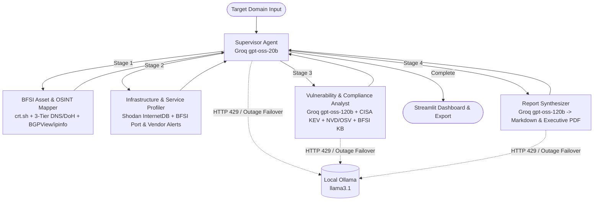

# FinRecon-Swarm: Autonomous BFSI Agentic Cybersecurity Framework

[](https://www.python.org/)
[](https://github.com/langchain-ai/langgraph)
[](https://console.groq.com/)
[](https://streamlit.io/)
[](#ethical-guardrail)
[](#automated-testing--failover-verification)

**FinRecon-Swarm** is an end-to-end, autonomous multi-agent cybersecurity framework built with **LangGraph** and **100% free, open-weight LLMs** (Groq cloud inference with automatic local Ollama failover). Purpose-built for the **Banking, Financial Services, and Insurance (BFSI)** sector, it performs strictly passive external attack surface discovery, prioritizes actively exploited vulnerabilities via **CISA KEV** and **NVD API 2.0**, maps technical findings directly to financial regulatory controls, and synthesizes CISO-ready **Markdown and Executive PDF** risk reports.

---

## Ethical Guardrail

> **100% Passive Reconnaissance Only:** FinRecon-Swarm relies exclusively on public threat intelligence and passive telemetry (Certificate Transparency logs, DNS/DoH, BGP/ASN registries, Shodan InternetDB, CISA KEV, NVD, and OSV). It performs **zero active exploitation**, **zero credential testing**, and **zero intrusive port scanning**. Run only against authorized targets or explicitly permitted sandboxes (such as `scanme.nmap.org`).

---

## Key Engineering Highlights

* **Zero-Cost, Resilient LLM Failover:** Routes fast orchestration to Groq (`openai/gpt-oss-20b`) and deep compliance/report synthesis to `openai/gpt-oss-120b` using native **JSON Mode**. If Groq returns `HTTP 429` (rate limit) or experiences an outage, execution fails over seamlessly to a local **Ollama (`llama3.1`)** instance without crashing the graph.
* **BFSI-Aware Asset Prioritization:** Automatically elevates high-value financial subdomains (`pay.*`, `portal.*`, `api.*`, `swift.*`, `vpn.*`, `auth.*`) from Certificate Transparency logs and passively detects expired SSL/TLS certificates.
* **3-Tier Resilient Networking:** Uses a cascading DNS resolver (`dnspython` -> OS socket -> Google DNS-over-HTTPS over Port 443) and dual-source ASN resolution (`BGPView` -> `ipinfo.io`), ensuring reliability even on restrictive campus or enterprise networks.
* **Active Exploitation & Supply-Chain Triage:** Cross-references discovered CVEs against the live **CISA KEV** catalog to flag active ransomware chains (**DORA Art. 11**), checks CVE publication age against the 30-day threshold (**PCI-DSS Req 6.3**), and flags exposed third-party perimeter appliances like Citrix, Fortinet, Cisco, and F5 (**DORA Art. 28**).
* **Executive Command Center & PDF Generation:** Streams LangGraph node transitions live in a **Streamlit** dashboard with KPI cards, an interactive severity-filterable Compliance Risk Register, a Failover Audit Log, and one-click styled **A4 Executive PDF** and **Markdown** exports.

---

## Multi-Agent Architecture



---

## Agent Swarm & Open-Source LLM Mapping

| Agent Node | Responsibility | Primary LLM (Free Tier) | Automatic Failover | Equipped Tools |
| :--- | :--- | :--- | :--- | :--- |
| **Supervisor** | Stateful DAG routing, loop protection, tactical directives | Groq (`openai/gpt-oss-20b`) | Ollama (`llama3.1`) | LangGraph State Router |
| **BFSI OSINT Mapper** | Passive subdomain discovery, expired SSL detection, DNS/DoH, ASN lookup | Deterministic Tool Node | N/A | `crt.sh`, `dnspython` + DoH, BGPView / `ipinfo.io` |
| **Infrastructure Profiler** | Passive port/service/CPE profiling, BFSI port & supply-chain alerts | Deterministic Tool Node | N/A | Shodan InternetDB API |
| **Vulnerability & Compliance Analyst** | CISA KEV / ransomware triage, NVD/OSV enrichment, regulatory control mapping | Groq (`openai/gpt-oss-120b`, JSON Mode) | Ollama (`llama3.1`) | CISA KEV, NVD API 2.0, OSV.dev, `bfsi_compliance_kb.md` |
| **Report Synthesizer** | CISO-ready Markdown & PDF risk report with 30/60/90-day remediation roadmap | Groq (`openai/gpt-oss-120b`) | Ollama (`llama3.1`) | `report_template.md`, `fpdf2` PDF Exporter |

---

## BFSI Regulatory Compliance Coverage

All vulnerability and perimeter findings are evaluated against the structured ruleset in `bfsi_compliance_kb.md`:

| Regulatory Framework | Primary Focus | Automated Trigger Examples |
| :--- | :--- | :--- |
| **PCI-DSS v4.0** | Cardholder data & payment infrastructure | Unpatched CVEs > 30 days (Req 6.3), expired/weak TLS on payment endpoints (Req 4.2), internet-exposed databases (Req 11.2), default configs (Req 2.2) |
| **DORA (EU)** | Operational resilience & ICT supply chain | DoS-prone vulnerabilities (Art. 9), CISA KEV ransomware chains & exposed backup ports (Art. 11), third-party appliances like Citrix/Fortinet/Cisco/F5 (Art. 28) |
| **NYDFS 23 NYCRR Part 500** | Banking cybersecurity baseline | Exposed RDP/SSH/VPN remote access lacking MFA verification (Sec 500.12), unencrypted HTTP/FTP/Telnet services (Sec 500.15) |
| **GLBA Safeguards Rule** | Consumer financial privacy | Information disclosure risks exposing PII or backend credentials |
| **OWASP API Top 10** | Open Banking & mobile API security | Unauthenticated API exposure (API1:2023) and SSRF-vulnerable web frameworks (API7:2023) |

---

## Quickstart

### 1. Clone & Create Virtual Environment
```powershell
git clone https://github.com/honeykushanth/finrecon-swarm.git
cd finrecon-swarm
python -m venv venv
.\venv\Scripts\Activate.ps1
pip install -r requirements.txt
```

### 2. Configure API Key & Local Failover
1. Copy `.env.example` to `.env` and insert your free API key from [console.groq.com](https://console.groq.com/).
2. Install [Ollama](https://ollama.com/download) and pull the local failover model:
```powershell
ollama pull llama3.1
```

### 3. Launch the Streamlit Command Center
```powershell
streamlit run app.py
```
Open `http://localhost:8501`, select an authorized target (e.g., `scanme.nmap.org`), and watch all 5 agents stream live results before exporting your Executive PDF or Markdown report.

### 4. Headless CLI Execution
```powershell
python -m agents.graph scanme.nmap.org
```
Generated reports are automatically saved in the `reports/` directory (sample outputs for `scanme.nmap.org` are included in `reports/scanme.nmap.org_bfsi_report.md` and `reports/scanme.nmap.org_bfsi_report.pdf`).

---

## Automated Testing & Failover Verification

Run the built-in 6-test verification suite to validate passive tools, compliance KB integrity, CISA KEV + NVD enrichment, PDF table sanitization, and **live Groq-to-Ollama failover**:

```powershell
python tests\test_suite.py
```

Covered test cases:
1. `test_01_compliance_kb_integrity` ? Verifies all 5 BFSI regulatory frameworks in `bfsi_compliance_kb.md`.
2. `test_02_passive_dns_and_asn` ? Validates resilient 3-tier DNS resolution and ASN ownership lookup.
3. `test_03_passive_internetdb_bfsi_alerts` ? Confirms Shodan InternetDB telemetry and NYDFS port alert triggers.
4. `test_04_cisa_kev_and_nvd_enrichment` ? Verifies live CISA KEV, DORA Art. 11 ransomware, and PCI-DSS 6.3 (>30d) tagging.
5. `test_05_groq_to_ollama_local_failover` ? Simulates Groq key/quota failure and proves seamless failover to local Ollama `llama3.1`.
6. `test_06_pdf_exporter_sanitization` ? Validates A4 PDF binary output, wide-table scaling, and Unicode/HTML sanitization.

---

## Repository Structure

```text
finrecon-swarm/
??? app.py                     # Streamlit Command Center (live streaming UI + PDF/MD export)
??? state_schema.py            # Shared LangGraph AgentState TypedDict schema
??? llm_factory.py             # Groq primary + local Ollama failover engine (with JSON Mode)
??? bfsi_compliance_kb.md      # Authoritative PCI-DSS v4.0, DORA, NYDFS, GLBA, OWASP API KB
??? report_template.md         # Executive BFSI report structure template
??? .env.example               # Environment variable template (safe for version control)
??? agents/
?   ??? nodes.py               # All 5 LangGraph agent node implementations
?   ??? graph.py               # Stateful LangGraph DAG compiler & streaming runner
??? tools/
?   ??? osint_tools.py         # Passive crt.sh scraper, 3-tier DNS/DoH, ASN failover
?   ??? infra_tools.py         # Shodan InternetDB profiler + BFSI port/vendor risk engine
?   ??? vuln_tools.py          # CISA KEV + NVD API 2.0 + OSV.dev prioritization engine
?   ??? agent_tools.py         # LangChain @tool wrappers
??? utils/
?   ??? pdf_exporter.py        # Styled A4 executive PDF report generator (fpdf2)
??? tests/
?   ??? test_suite.py          # Automated unit, compliance, PDF, and Ollama failover tests
??? reports/                   # Generated Markdown and Executive PDF sample reports
```
